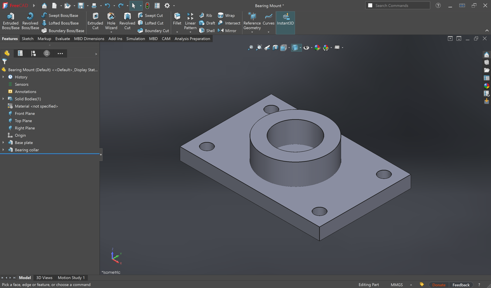
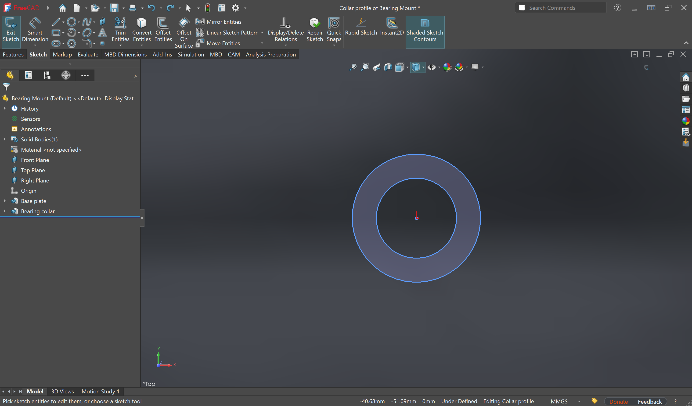

# FreeWorks — FreeCAD add-on

**0.4.1-alpha · FreeCAD 1.1.4 · Windows**

**Like the SOLIDWORKS interface and want to work in FreeCAD?** FreeWorks brings a familiar commercial-CAD workflow to stock FreeCAD 1.1.4, from the first sketch through parts, assemblies, and drawings.

FreeWorks is an independent add-on for FreeCAD. Install it into your existing FreeCAD setup. The application still appears as **FreeCAD**.

[**Download the latest release**](https://github.com/PlasticBuild/FreeWorks/releases/latest) · [Installation guide](docs/INSTALL.md) · [Report an issue](https://github.com/PlasticBuild/FreeWorks/issues)

## What's new in 0.4.1-alpha

0.4.1-alpha fixes a crash when reopening an assembly with linked parts. It also includes the 0.4.0 improvements, including Smart Dimension drag placement, per-component configurations in assemblies, and theme-matched ribbon and feature-tree icons. [Release notes](https://github.com/PlasticBuild/FreeWorks/releases/tag/v0.4.1-alpha)

## What you can try

| Area | Workflow |
| --- | --- |
| Interface | Find commands on ribbon-style tabs, edit feature settings in task panels, and step through the model with the feature tree and rollback bar. Light and dark themes are available. |
| Sketching | Snap to endpoints, midpoints, and centres. Use inference lines and automatic relations as you draw, then set sizes with Smart Dimension. |
| Part modelling | Turn sketches into parts with extrudes, revolves, sweeps, and lofts. Refine them with fillets, holes, patterns, and mirrors. |
| Assemblies | Insert components and position them with mates. Check for interference or create an exploded view. |
| Drawings | Create projected, section, and detail views, add dimensions and annotations, and export to PDF or DXF. |

Sketching is the best place to start. The walkthrough below takes you from a snapped rectangle to an extruded part. This is an early alpha, so expect rough edges and verify results before relying on them.

## Screenshots

**Part workspace.** A bearing mount with the Features ribbon and model tree visible.

**Sketch editor.** The bearing collar profile in edit mode with the Sketch ribbon visible.

## Requirements and quick install

Use stock FreeCAD **1.1.4**. Windows has been tested. Other operating systems are untested.

- **Addon Manager:** add `https://github.com/PlasticBuild/FreeWorks` as a custom repository on branch `main`, then install FreeWorks and restart FreeCAD.
- **ZIP:** download the add-on ZIP from the latest release and extract it to your FreeCAD `Mod` folder so that `Mod/FreeWorks/InitGui.py` exists. [Download and install](docs/INSTALL.md)

Orca, Bambu, PrusaSlicer, and Diotopo are optional in-app downloads. Each is downloaded separately. The add-on package excludes all four.

## Icons

The add-on ships its alpha icon set in `swstyle/resources/icons`: a light set (`png/`, `fc/`) and a dark set (`dark/`). It picks the set that matches FreeCAD's theme. These icons were made with AI tools for this alpha and are styled after the commercial-CAD look this add-on follows. A command that has no icon in the set uses the add-on's drawn icon (`swstyle/resources/icons-drawn`), then FreeCAD's own icon, then a tile with its initials.

The package also includes the ANSI and ISO drawing sheet formats (`swstyle/sheetformats`), the 3D Slicer tab pictures, which were drawn for this add-on (`swstyle/resources/slicer`), and the environment pictures (`swstyle/resources/environments`). The environment pictures are made from Poly Haven CC0 HDRIs; see the LICENSE.txt in that folder. The tip pictures are not included yet.

To use icons of your own instead, set the `IconRoot` preference (Tools > Edit parameters > Preferences/Mod/FreeWorks) or the `SWSTYLE_ICONS` environment variable to a folder with the same layout, and restart FreeCAD.

## Repository layout

The add-on source lives at the root of this repository. The repository root is the add-on folder, so it installs as `Mod/FreeWorks` with no extra steps.

| Path | What it holds |
| --- | --- |
| `Init.py`, `InitGui.py` | Start-up files that FreeCAD runs. `InitGui.py` applies the interface. |
| `package.xml` | Add-on metadata for the Addon Manager: name, version, licence, and icon. |
| `swstyle/` | The interface, sketch tools, features, assemblies, drawings, and their resources. |
| `smcore/` | The bundled SheetMetal engine, unmodified (LGPL, see `THIRD-PARTY.md`). |
| `swfiles/` | File import and export helpers. |
| `icons/` | The add-on's own icon. |
| `docs/` | Install, feedback, and alpha guides, plus the screenshots on this page. |
| `.github/workflows/release.yml` | Builds the release zip from the tagged source. |

Releases are only for tagged builds. Pushing a tag such as `v0.4.1-alpha` builds `FreeWorks-0.4.1-alpha.zip` with `git archive` from that tag, so the zip always matches the committed source. The tag must match the version in `package.xml`.

## Install from source

1. Find your user `Mod` folder. In FreeCAD's Python console, enter `App.getUserAppDataDir()`. The `Mod` folder sits inside that path. On a new FreeCAD 1.1 profile it is `%APPDATA%\FreeCAD\v1-1\Mod` on Windows and `~/.local/share/FreeCAD/v1-1/Mod` on Linux. A profile carried over from an older FreeCAD can still use `%APPDATA%\FreeCAD\Mod`.
2. Close FreeCAD. Then clone the repository into that folder as `FreeWorks`, for example on Windows:
   `git clone https://github.com/PlasticBuild/FreeWorks.git "%APPDATA%\FreeCAD\v1-1\Mod\FreeWorks"`
3. Check that `InitGui.py` sits directly inside `Mod/FreeWorks`, then start FreeCAD.
4. To update later, close FreeCAD, run `git pull` in that folder, and start FreeCAD again.

Without git, use **Code > Download ZIP** on this page, extract it, and rename the `FreeWorks-main` folder to `FreeWorks` before you move it into `Mod`.

## First 15 minutes

1. Open a new part, select a plane, and open a sketch.
2. Draw a rectangle. Start a line near a corner or the midpoint of an edge and watch the snap cue. Move the pointer horizontally or vertically to see the inference line and relation appear as you draw.
3. Remove the practice line so the rectangle is the only profile. Use Smart Dimension on two adjacent edges and enter their lengths in the Modify box.
4. Exit the sketch, select the rectangle sketch, and use Extrude. Enter a depth and accept the preview.

## Alpha feedback

Everyone is welcome to report bugs and suggest improvements. Include your FreeCAD and FreeWorks versions, the steps to reproduce the issue, and any relevant Report View output or screenshots. [GitHub Issues](https://github.com/PlasticBuild/FreeWorks/issues) · [Feedback guide](docs/FEEDBACK.md)

## Guides

- [Install, update, or remove FreeWorks](docs/INSTALL.md)
- [Download the six-column icon comparison PDF](https://raw.githubusercontent.com/PlasticBuild/FreeWorks/main/docs/FreeWorks-Icon-Comparison.pdf)
- [Historical 0.3.0-alpha1 status notes](STATUS.md)
