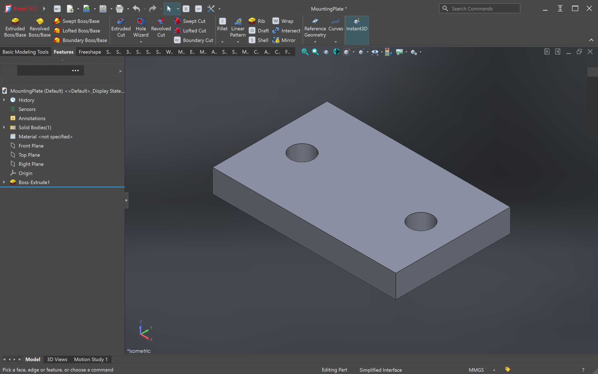
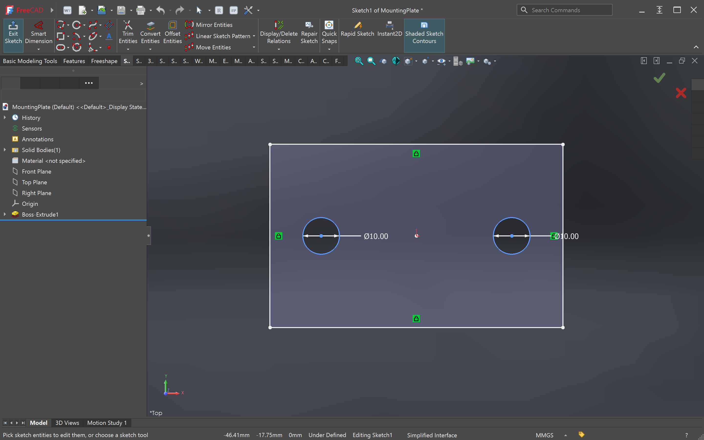

# FreeWorks — FreeCAD add-on

**0.3.0-alpha1 · Windows tested · Other operating systems untested**

**Like the SOLIDWORKS interface and want to work in FreeCAD?** FreeWorks brings a familiar commercial-CAD workflow to stock FreeCAD 1.1.4, from the first sketch through parts, assemblies, and drawings.

FreeWorks is an independent add-on for FreeCAD. Install it into your existing FreeCAD setup. The application still appears as **FreeCAD**.

## What you can try

| Area | Workflow |
| --- | --- |
| Interface | Find commands on ribbon-style tabs, edit feature settings in task panels, and step through the model with the feature tree and rollback bar. Light and dark themes are available. |
| Sketching | Snap to endpoints, midpoints, and centres. Use inference lines and automatic relations as you draw, then set sizes with Smart Dimension. |
| Part modelling | Turn sketches into parts with extrudes, revolves, sweeps, and lofts. Refine them with fillets, holes, patterns, and mirrors. |
| Assemblies | Insert components and position them with mates. Check for interference or create an exploded view. |
| Drawings | Create projected, section, and detail views, add dimensions and annotations, and export to PDF or DXF. |

Sketching is the best place to start. The walkthrough below takes you from a snapped rectangle to an extruded part. This is an early alpha, so expect rough edges and verify results before relying on them.

## Screenshots

**Part workspace and feature tree.** Ribbon commands across the top, model history and the blue rollback bar on the left, and a two-hole mounting plate in the viewport.

**Sketch editing.** The same plate in sketch mode, showing the sketch tools, shaded contour, constraint indicators, and hole diameters.

## Requirements and quick install

- Use stock FreeCAD **1.1.4**. Windows has been tested. Other operating systems are untested.
- Follow the [manual installation guide](docs/INSTALL.md). Alpha access is by invitation. The public repository is the place to read the documentation.

Orca, Bambu, PrusaSlicer, and Diotopo are optional in-app downloads. Each is downloaded separately. The add-on package excludes all four.

## First 15 minutes

1. Open a new part, select a plane, and open a sketch.
2. Draw a rectangle. Start a line near a corner or the midpoint of an edge and watch the snap cue. Move the pointer horizontally or vertically to see the inference line and relation appear as you draw.
3. Remove the practice line so the rectangle is the only profile. Use Smart Dimension on two adjacent edges and enter their lengths in the Modify box.
4. Exit the sketch, select the rectangle sketch, and use Extrude. Enter a depth and accept the preview.

## Guides

- [Install, update, or remove FreeWorks](docs/INSTALL.md)
- [Give feedback](docs/FEEDBACK.md)
